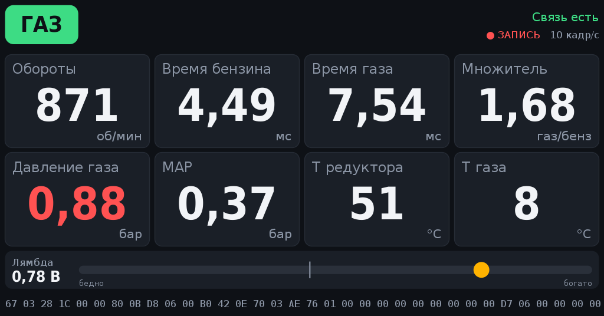

# ГБО Монитор

Android-приложение для автомагнитолы: показывает текущие параметры газового блока **AEB MP48** (и ребрендингов, например Pride) по штатному диагностическому кабелю USB на PL2303.



> **Неофициальная программа.** Не связана с AEB, Pride и другими производителями ГБО. Протокол получен наблюдением обмена штатной программы с блоком (запись USB-трафика), без дизассемблирования ПО. Приложение читает данные и отправляет блоку только одну команду записи — переключение газ/бензин по кнопке, той же последовательностью байт, что и штатная программа. Используйте на свой риск.

## Возможности

- **Табло:** обороты, время впрыска бензина и газа, множитель, давление газа, MAP, температуры редуктора и газа, лямбда; режим блока (бензин / ожидание газа / газ).
- **Переключение газ/бензин** кнопкой на экране.
- **Графики** за 1 или 5 минут: множитель, давление, лямбда, Tб/Tг.
- **Предупреждения со звуком:** низкое давление на газу, аварийный переход на бензин при низком давлении («кончается газ?»), нет перехода на газ дольше заданного времени.
- **Статистика:** время и пробег (по GPS магнитолы) на газу и бензине, доля газа, оценка расхода газа с калибровкой по заправкам до полного.
- **Мини-панель поверх навигатора**, работа в фоне.
- **Запись** в `Загрузки/AEB/aeb-ДАТА.txt` (как txt-логи штатной программы + байт состояния и сырой кадр), автозапись при подключении.
- Свой драйвер PL2303 (USB Host API), без сторонних библиотек и root. Автозапуск при подключении кабеля.

## Требования

- Android 5.0+ с USB Host (проверено на магнитоле RK3326, Android 11).
- Диагностический кабель блока на PL2303 (Prolific, VID 067B).
- Пока работает приложение, штатная программа на ПК к блоку подключиться не может.

## Сборка в Android Studio

1. File → Open → папка проекта. Studio сама скачает Gradle 8.9 и Android Gradle Plugin 8.7.
2. Если попросит — установите Android SDK Platform 34 (SDK Manager).
3. Build → Build App Bundle(s) / APK(s) → Build APK(s). APK: `app/build/outputs/apk/debug/app-debug.apk`.
4. Тесты протокола и предупреждений: правой кнопкой по `app/src/test` → Run Tests.

### Подпись

Чтобы APK ставился поверх уже установленного приложения, он должен быть подписан тем же ключом. Положите ключ и файл `keystore/keystore.properties`:

```properties
storeFile=keystore/ваш-ключ.jks
storePassword=...
keyAlias=...
keyPassword=...
```

Папка `keystore/` исключена из git (`.gitignore`). Без неё сборка подписывается отладочным ключом Android Studio.

## Сборка без Android Studio (Ubuntu/Debian)

```bash
sudo apt install default-jdk android-sdk-platform-23 android-sdk-build-tools \
                 dalvik-exchange apksigner zipalign aapt zip junit4
./tools/build-nogradle.sh     # → build-nogradle/AEB-Monitor-<версия>.apk
./tools/run-tests.sh          # юнит-тесты
```

Версия, minSdk и targetSdk берутся из `app/build.gradle`.

## Структура

| Путь | Назначение |
|---|---|
| `app/src/main/java/.../Protocol.java` | Формат запросов/ответов, разбор кадра, команды переключения топлива |
| `Pl2303.java` | Драйвер кабеля PL2303 (Prolific HX, 9600 8N1) |
| `AebLink.java` | Поток обмена: проверка связи, опрос 10 раз/с, переключение топлива |
| `MonitorService.java` | Фоновая служба: связь, запись, статистика, предупреждения, мини-панель, GPS |
| `MainActivity.java` | Окно: страницы, кнопки, меню, разрешения USB/GPS/оверлея |
| `DashView` / `TrendView` / `StatsView` | Экраны (Canvas, масштабируются под любой размер) |
| `OverlayPanel.java` | Мини-панель поверх других приложений |
| `Alerts.java`, `Stats.java`, `Trend.java` | Предупреждения, статистика, буфер графиков |
| `app/src/test/` | Тесты: разбор 1738 записанных кадров, команды переключения, предупреждения |
| `docs/PROTOCOL.md` | Описание протокола |

## Автор

AndrewT · tynyanyi@mail.ru · https://github.com/AndreyTSpb/mp48-monitor

## Лицензия

[MIT](LICENSE).
